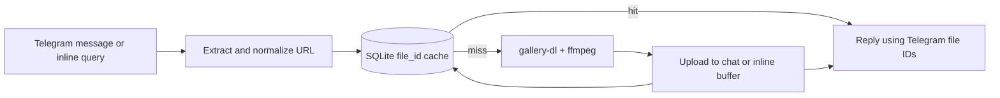

# selfhost-tg-downloader

**A self-hosted Telegram bot that turns TikTok and Instagram links into videos and photos in your chats.**

[](https://github.com/Mac3g0d/selfhost-tg-downloader/actions/workflows/ci.yml)
[](https://www.python.org/)
[](https://docs.astral.sh/uv/)
[](https://docs.aiogram.dev/)
[](LICENSE)

## What it does

- Detects TikTok and Instagram URLs in text messages, downloads media with `gallery-dl`, and replies with video or photo files.
- Reuses Telegram `file_id` values from a SQLite cache rather than downloading the same normalized URL again.
- Supports inline queries: type `@your_bot <URL>` in a chat after enabling inline mode through BotFather.
- Accepts Instagram credentials or an exported cookies file; credentials take precedence.
- Runs as a non-root container, with structured logging to stdout and `ffmpeg` available for media processing.

The interface and bot messages are currently in Russian. This is a polling bot: no inbound HTTP endpoint, webhook, or automatic deployment is configured.

## Quick start with Docker

Requires Docker Engine and Docker Compose v2.

```bash
git clone https://github.com/Mac3g0d/selfhost-tg-downloader.git
cd selfhost-tg-downloader
cp .env.example .env
# Edit .env: set TELEGRAM_BOT_TOKEN to your own BotFather token.
docker compose up -d --build
docker compose logs -f bot
```

Compose builds the **runtime** target. Named volumes persist downloads and `/app/data` (the SQLite cache); `./cookies` is mounted read-only. The image runs as UID/GID `1000:1000`; ensure any replacement bind mounts are writable by that user. Compose rotates container logs (10 MB, three files). No token or cookies should be committed to Git.

To build the runtime image separately:

```bash
docker build --target runtime -t selfhost-tg-downloader:local .
```

Release images are intended for `ghcr.io/mac3g0d/selfhost-tg-downloader:vX.Y.Z` **after a successful tagged release**. The existence of this pipeline does not mean an image has already been published.

## Configuration

Settings are loaded from environment variables and an optional `.env` file. Environment names are case-insensitive.

| Variable | Default | Purpose |
| --- | --- | --- |
| `TELEGRAM_BOT_TOKEN` | Required | BotFather token; keep private. |
| `BUFFER_CHAT_ID` | `0` | Private buffer chat/channel ID for inline uploads; `0` disables inline delivery. |
| `DATABASE_PATH` | `data/cache.db` | SQLite cache file, relative to the working directory. |
| `DOWNLOAD_DIR` | `~/.cache/tg-downloads` | Download workspace; the container and Compose override this to `/app/downloads`. The sample `.env` overrides it to `/tmp/tg-downloads` for local use. |
| `DOWNLOAD_TIMEOUT` | `120` | Download subprocess timeout, in seconds. |
| `COOKIES_FILE` | `cookies/instagram.txt` | Optional cookies file; Compose uses `/app/cookies/instagram.txt`. See [cookies setup](cookies/README.md). |
| `INSTAGRAM_USER` / `INSTAGRAM_PASS` | Empty | Optional Instagram credentials; both are required to use this authentication method. |
| `MAX_TELEGRAM_FILE_SIZE` | `52428800` | Per-file upload check in the regular message handler (50 MiB). |
| `GALLERY_DL_BIN` | `gallery-dl` | Downloader executable. |
| `USE_ARIA2` | `false` | Pass an aria2 downloader option; requires an independently installed `aria2c` executable. Not included in the runtime image. |
| `CONCURRENT_FRAGMENTS` | `5` | Forwarded as the `ytdl.concurrent-fragments` option. |

### Inline setup

1. Enable inline mode for your bot through BotFather.
2. Create a private buffer channel, add the bot with permission to post, and set `BUFFER_CHAT_ID` to its numeric ID.
3. Restart the bot and query `@your_bot <supported URL>`.

On a cache miss, inline media is uploaded to that buffer to obtain reusable Telegram file IDs. Video/photo entries become inline results. Captions in the buffer include the requesting user's name, ID, optional username, chat type, and source URL: choose who can access that channel accordingly.

## How it works



The `src` Python package contains configuration, startup, handlers, downloader, and database modules. Tests live in `tests/`. [agents.md](agents.md) contains additional architectural notes.

Normalization strips query parameters, fragments, and trailing slashes before cache lookup. Cache entries are shared between regular and inline handlers and stored without an expiry policy. A cache hit does not re-check the source site. Download workspaces are normally cleaned after processing; buffer messages remain in Telegram.

## Local development

Install Python 3.14+, [uv](https://docs.astral.sh/uv/getting-started/installation/), and `ffmpeg`. Set up `.env` as above. Development tools are a dependency **group**, not an optional extra:

```bash
uv sync --frozen --group dev
uv run --frozen python -m src
```

Run the same source checks as CI:

```bash
uv run --frozen pytest -q -o tmp_path_retention_policy=all
uv run --frozen mypy src
uv run --frozen ruff check src tests
uv run --frozen ruff format --check src tests
uv run --frozen ty check src
uv run --frozen bandit -r src
```

Or run tooling in the CI image:

```bash
docker build --target ci -t selfhost-tg-downloader:ci .
docker run selfhost-tg-downloader:ci pytest -q -o tmp_path_retention_policy=all
docker run -v "$PWD:/repo:ro" selfhost-tg-downloader:ci gitleaks git /repo --log-opts="--all" --redact
docker save selfhost-tg-downloader:local -o runtime.tar
docker run -v "$PWD:/images:ro" selfhost-tg-downloader:ci trivy image --input /images/runtime.tar --scanners vuln --severity HIGH,CRITICAL --exit-code 1
```

The tests do not require Telegram or Instagram accounts. Settings are isolated and destructive cleanup calls are mocked in cleanup tests. There is no coverage percentage or test-count badge: the Actions logs are the source of truth for the current run.

## CI and releases

[CI and release](.github/workflows/ci.yml) runs on GitHub-hosted Ubuntu runners for every PR opening, new commit, and reopening, and for pushes to `main`. There are no path filters, and new commits do not cancel earlier check runs. Independent tag pushes do not trigger this pipeline.

1. **Build once:** create CI and runtime images using `uv sync --frozen`; export them as checksum-verified Actions artifacts retained for one day. Runtime dependencies are installed separately from developer tools.
2. **Parallel jobs:** pytest (plus an installed-runtime import smoke test), mypy, Ruff lint/format, ty, Bandit, full-history Gitleaks, and Trivy against the actual runtime archive.
3. **Security gate:** Trivy fails on HIGH or CRITICAL findings, including unfixed findings. Scanner/network failures also fail the job. There are no blanket security bypasses or `continue-on-error` steps.
4. **Merged-main-only release:** after *every* check passes for that exact main SHA, the GitHub API must associate it with a PR merged into `main` whose `merge_commit_sha` matches. Direct pushes and open PRs cannot publish. The version in `pyproject.toml` determines `vX.Y.Z`; an existing release for that version is skipped. API errors fail closed. A separate release job verifies the installed runtime version, pushes the **same checked image without rebuilding** to GHCR, verifies its image ID, and creates the tag and GitHub Release at the checked main SHA with its registry digest attached. Only that job has package/content write permissions.

Maintainers: update the project version and lockfile together in a reviewed PR, then merge when ready to publish. Successful checks for the merged main commit trigger publication automatically if that version has no release. An existing tag without a corresponding release is treated as an error requiring manual resolution rather than silently repointed. Configure branch protection to require PR review and checks as appropriate; this change does not modify repository protection. The workflow never deploys anything. Publication is intentionally not tested end-to-end from a PR, and unit-test success alone does not verify a real release.

## Limits and operational notes

- Availability depends on upstream extractors, authentication, rate limits, and Telegram Bot API restrictions. Login does not guarantee that every private or restricted post is downloadable.
- The 50 MiB check is applied **after download** by the regular message handler. It is not a disk quota, and the inline handler does not currently apply the same explicit size check. Provision disk space and external resource limits.
- No per-user access control, request queue, download deduplication for concurrent misses, cache eviction, or metrics endpoint is implemented.
- `gallery-dl` may need additional optional downloaders for some media; the image provides `gallery-dl` and `ffmpeg`, not every optional backend.
- Treat tokens, cookies, generated authentication files, database contents, and buffer channel messages as sensitive. Use a dedicated bot/account and restrict server access.
- Vulnerable upstream OS/media packages can block the strict Trivy gate even when application tests pass. Fix or replace the affected dependency; do not bypass the gate to publish.

## License

[MIT](LICENSE).
